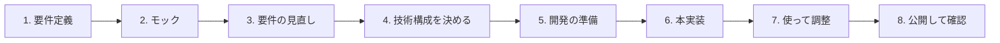

# 実装計画

- 版：0.1（ドラフト）
- 最終更新：2026-11-12

要件定義から本実装、動かして調整するところまでの進め方をまとめる。何を作るか（仕様）の正本は [要件定義書](requirements.md) で、この資料では**どの順で、何を決めて、何を作るか**を扱う。

「未確定」と書いたものは、まだ決まっていない。決まったらこの資料と要件定義書の両方に反映する。

---

## 1. 全体の流れ

| 段階 | 中身 | 状態 | 次に進む条件 |
|---|---|---|---|
| 1. 要件定義 | 仕様を決めて要件定義書に書く | 技術構成以外は決定（v0.6） | — |
| 2. モック | 画面の作りをHTMLとJavaScriptで確かめる | 作成中（残り：新刊候補、設定） | すべての画面でOKが出る |
| 3. 要件の見直し | モックで決まったことと、残った未決定の事項を整理する | 未着手 | 技術構成以外の未決定の事項がなくなる |
| 4. 技術構成を決める | 使う言語・フレームワーク・データベース・インフラなどを決める | 未着手 | 決めることの表（4章）がすべて埋まる |
| 5. 開発の準備 | APIキーの取得、プロジェクトの雛形、開発環境、ラベルなど | 未着手 | 手元で雛形が動き、本番環境にも置ける |
| 6. 本実装 | マイルストーンごとに機能を作る | 未着手 | M1〜M7 が終わる |
| 7. 使って調整 | 実際のデータで使い、自動の判定などを調整する | 未着手 | — |
| 8. 公開して確認 | AWSで公開して動作を確かめ、終わったら環境を削除して費用を止める | 未着手 | 環境を削除し、費用が止まったことを確かめる |

段階1の要件定義書は、ほかの段階でも正本として直し続ける。

---

## 2. 作業の単位

どの段階でも、1つの作業ごとに次の流れで進める（[CLAUDE.md](../CLAUDE.md) とそこから参照している全プロジェクト共通のルールのとおり）。

1. Issue を作る
2. `main` から作業ブランチを切る
3. 作って、コミットする
4. 画面や文書など、見てもらう必要があるものは、OKが出てから push して PR を作る
5. マージはユーザーが行う

仕様が変わったら、同じ PR の中で要件定義書も直す。

**日程**：期限は決めない。毎日少しずつでも進める。そのため、Issue はなるべく1日で終わる大きさに分ける。

---

## 3. 段階ごとの中身

### 3.1 要件定義（済み）
- 要件定義書 v0.6 まで作った。技術構成（7章）だけが未決定

### 3.2 モック
**作った画面**：ログイン、本棚、シリーズページ、ブックページ、本の登録

**残りの画面**（1画面ずつ作り、見てもらってから PR を出す）

| 順 | 画面 | 中身 |
|---|---|---|
| 1 | 新刊候補 | 全シリーズの未判定の候補、［本棚に追加］［対象外］、全体一括の新刊検索の進み具合と中止 |
| 2 | 設定 | 未所持の既刊の表示、表示の色、タグの管理、対象外一覧 |

- モックでは作らず、本実装で作るもの：手で入力した本の書誌情報をブックページで直す機能（要件定義書 3.1）

### 3.3 要件の見直し
- モックで決まったことが要件定義書に反映されているかを確かめる
- 7章の未決定の事項と保留中の案を見直し、技術構成を決める前に決めておくべきものがないかを確かめる
- 実際のデータで確かめてから決めること（3.7）は、ここでは決めない

### 3.4 技術構成を決める
すべて未確定。候補を比べて利点を説明し、ユーザーが選ぶ。決まったものから要件定義書の7章に書く。

**決めること**

| 項目 | 決めること | 要件定義書から来る条件 |
|---|---|---|
| フロントエンド | 言語、フレームワーク（使うかどうかも） | PCとスマホの両方で使いやすい画面（1.2）。重ねて開くページ（4.7） |
| サーバー側 | 言語、フレームワーク、動かす場所 | 外部APIはサーバー側からだけ呼ぶ（2.1）。処理の入口をまとめる（6.1） |
| データベース | 種類、置く場所 | データモデル（5章） |
| インフラ | AWSの中で使うサービス（AWSを使うことは決定）。本番環境に途中の段階（M1など）で一度置くかどうかも、ここで決める | AWSの無料枠は使い切っているので、なるべくコストを抑える。公開して確かめたら環境を削除する（7章）。ほかのプロジェクトのやり方を参考にする |
| 表紙の画像の保存先 | 手で入力した本の画像を置く場所 | 7章 |
| ログイン | 本番環境で、自分以外が使えないようにする方法（ユーザー登録は作らない。3.8） | 当面は本人だけが使う（1.2）。認証を足すだけでマルチユーザーにできる作り（6.1） |
| 秘密情報の管理 | 楽天APIのキーなどを置く場所 | キーを隠す（2.1）。秘密情報はコミットしない |
| アクセスログ | 選んだサービスが自動で記録するログの扱い | アクセスログは記録しない（6.2） |
| テスト | 何をどの方法で確かめるか | — |
| CI | プルリクエストで自動で走らせるもの | — |

### 3.5 開発の準備
- 楽天ウェブサービスでアプリを登録し、`applicationId` と `accessKey` を取る。キーはリポジトリに入れない
- プロジェクトの雛形を作り、起動の手順を README に書く
- 実装用の領域ラベル（例：`frontend` `backend` `db`）を作り、CLAUDE.md に書く。分け方は技術構成によるので、名前は技術構成と一緒に決める
- CLAUDE.md にディレクトリの構成や起動ポートなど、このリポジトリ固有のことを足す
- CI を用意する（中身は技術構成による）
- `mock/` は本実装を始めたあとも残す

### 3.6 本実装
**進め方**
- 機能をマイルストーンに分け、上から順に作る。データがないと表示を確かめられないため、登録を表示より先に作る
- 1つのマイルストーンは、いくつかの Issue に分けて進める
- マイルストーンごとに、PCとスマホの両方で動作を確かめる
- 本番環境に途中の段階（M1など）で一度置くかどうかは、コストと合わせて技術構成（3.4）で決める。早く置くと、インフラの問題を早く見つけられる

**マイルストーン（案）**

| | 名前 | 中身 | 要件定義書 |
|---|---|---|---|
| M1 | 土台 | データベースのテーブル、固定のユーザー、ログイン、画面の枠（サイドメニュー、重ねて開くページ、表示の色） | 4.2、4.7、5章、3.8（表示の色） |
| M2 | 本の登録 | 楽天APIでの検索、登録内容の入力、シリーズの作成と初期値 | 2.2、3.1（手で入力する部分を除く）、3.5、4.3 |
| M3 | 本棚・シリーズページ・ブックページ | 一覧（グリッドとリスト）、ステータスの表示と編集、削除、集計の値 | 3.2、3.5、3.9、4.4 |
| M4 | 本棚の検索 | テキスト検索、絞り込み、並べ替え、少しずつの読み込み、キャッシュ | 3.4、3.6、4.5、4.6、4.8 |
| M5 | 新刊検索 | シリーズ単位の検索、除外と分類、候補の表示と操作、全体一括の検索、新刊候補の画面 | 3.7 |
| M6 | 設定 | 未所持の既刊の表示、タグの管理、対象外一覧 | 3.3、3.8 |
| M7 | 手で入力して登録 | 手で入力した本の登録、表紙の画像のアップロード、ブックページでの書誌情報の修正 | 3.1（手で入力して登録） |

- M7 は表紙の画像の保存先（3.4）が決まっている必要がある。保存先の都合で順番を変えることがある
- ログインの作り方は 3.4 で決める。決まった内容によっては M1 から外す

### 3.7 使って調整
本実装のあと、実際のデータで使って調整する。要件定義書で「実際に作って触ってから決める」としたもの。

- 楽天の `seriesName` にレーベル名が入る場合の扱い（シリーズの表示名や検索キーワードをどこから作るか。3.5）
- 追う判型の自動の決め方（3.5）
- 新刊検索の除外と正規化（3.7.3）、巻数の抽出（3.7.5）がうまく働くか

直した内容は要件定義書にも反映する。

### 3.8 公開して確認
学習が主な目的なので、AWSで公開して動作を確かめたら、環境を削除して費用を止める。

- 公開した状態で、PCとスマホから一通りの操作を確かめる
- 確かめ終わったら環境を削除し、AWSの請求で費用が止まったことを確かめる
- 利用者は当面は開発者本人だけにする（要件定義書 1.2）。ユーザー登録は作らないが、作りは自分以外も使うことを想定したものにする（6.1）
- 段階8まで終えて、いったん完成と言えるところまで来たら、ユーザー登録を作るかどうかを考え直す。作る場合は、プライバシーポリシー、利用規約、退会機能（6.3）も合わせて検討する
- ストアへのリンク（3.10、6.4）は、一般に公開するときに検討する

---

## 4. 未確定の事項
- 技術構成（3.4 の表のすべて。本番環境に途中の段階で置くかどうか、実装用の領域ラベルの名前も、技術構成と一緒に決める）
- ユーザー登録を作るかどうか（段階8のあとで考え直す）
